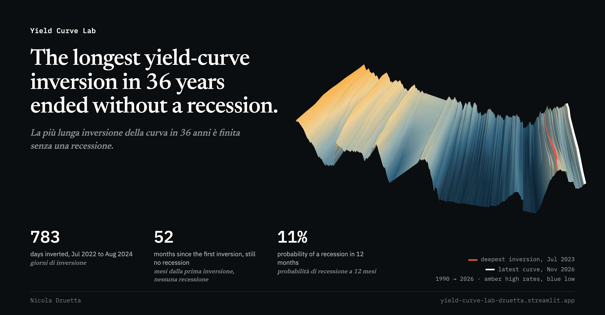
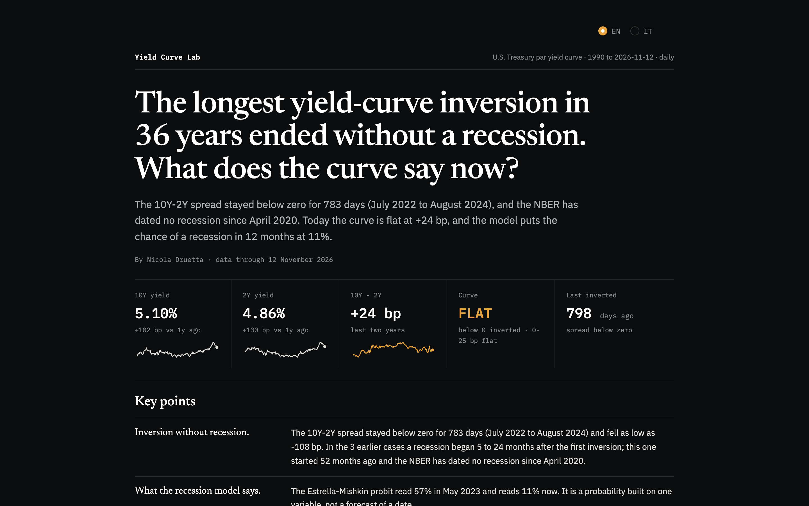
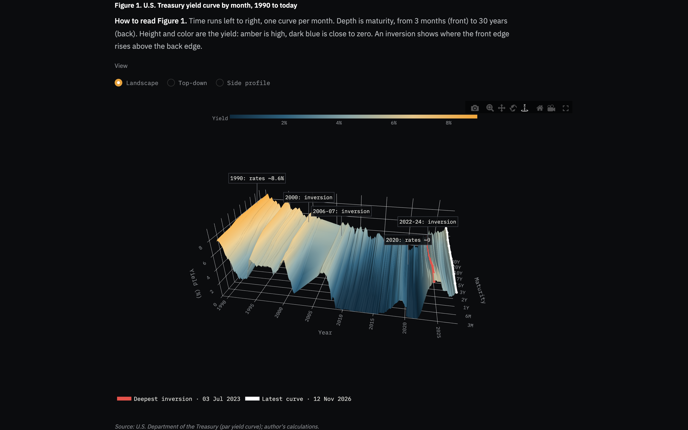

# Yield Curve Lab

A macro dashboard built around the **U.S. Treasury yield curve**: 36 years of curves as a 3D surface,
a recession-probability model, the real policy rate, and market-implied inflation expectations.

**Live demo:** https://yield-curve-lab-druetta.streamlit.app/

The page opens in Italian or English depending on the visitor's browser language. Add `?lang=it` or `?lang=en` to the address to force one, or use the EN / IT switch at the top.



## Screenshots





## What it covers

| Section | Concept |
|---|---|
| **Surface** | Every monthly yield curve since 1990 as a rotatable 3D landscape, with labelled events and three camera views |
| **The signal** | 10Y − 2Y spread, inversion episodes, NBER recessions |
| **Recession probability** | Estrella-Mishkin (1996) probit on the 10Y − 3M spread, estimated on monthly data since 1960 (nine recessions). Coefficients land close to the published ones; the page shows the current estimate, fit statistics and the current probability |
| **Credit** | Does the credit market add information? Moody's Baa minus the 10-year Treasury, compared with the term spread in three probit models (term only, credit only, both) at three horizons. The high-yield (junk bond) index minus the 3-month T-bill is shown separately: FRED only provides the last three years |
| **Monetary policy** | Real policy rate (fed funds − CPI inflation) and the Sahm rule on unemployment |
| **Inflation expectations** | Fisher equation: nominal = real (TIPS) + breakeven; 5y5y forward inflation = 2 × BE10 − BE5 |
| **Europe and Italy** | BTP-Bund spread since 1991 (lira era, euro, 2011-12 crisis, “whatever it takes”), Spain and France, and the slope of the curve in the U.S. vs the euro area |
| **Compare two days** | Overlay the curve of any two dates |
| **Nelson-Siegel** | A whole curve described by level, slope, curvature and tau, fitted by multi-start least squares |

Every number in the text is computed from the data, none is typed by hand.
The page is bilingual (English / Italian, switch at the top or `?lang=it`); technical terms such as *spread*, *breakeven* or *probit* are kept in English in the Italian version. All texts live in `i18n.py`.

## How it is built

```
fetch_data.py -> db.py (SQLite) -> analysis.py -> app.py (Streamlit + Plotly) + i18n.py (texts)
 Treasury, FRED   SQL tables        macro models     the dashboard
```

- **Data**: U.S. Treasury par yield curve (1990), Treasury real yield curve (TIPS), FRED series
  (FEDFUNDS, CPIAUCSL, UNRATE, USREC, GS10, TB3MS, BAA, BAMLH0A0HYM2EY, plus OECD 10-year yields and 3-month rates for Germany, Italy, France, Spain and the U.S.). All public, no API key.
- **Storage**: SQLite (`yields`, `real_yields`, `fred` tables), queried with SQL joins and aggregations
  (see `queries.sql`).
- **Analysis**: pandas, SciPy (probit by maximum likelihood, Nelson-Siegel fit), NumPy.
- **Visualisation**: Plotly 3D surface and 2D charts, Streamlit, custom CSS.

## Run it locally

```bash
python3 -m venv .venv
source .venv/bin/activate
pip install -r requirements.txt
python db.py              # first time only: downloads the history and builds data/yields.db
streamlit run app.py
```

The app opens at once with the saved data. If the latest Treasury date is two or more days old, it refreshes the data in the background (on a copy of the database, swapped in atomically, so a failed download never breaks the page). A refresh re-downloads the last two calendar years, so nothing is lost at the turn of the year.

## Tests

```bash
pip install -r requirements-dev.txt
python -m pytest
```

The tests use synthetic data (no network, no database) and cover the curve-state thresholds, inversion episodes and
clusters, the lead time between inversion and recession, the Nelson-Siegel fit, the 3-month rate conversion and the
recession bands, the probit fit and the comparison of the term and credit models.

## Regenerating the images

```bash
pip install -r requirements-dev.txt
python -m playwright install chromium
python docs/make_cover.py                # cover image
streamlit run app.py &                    # then, with the page running:
python docs/make_page_screenshots.py     # screenshots of the real page
```

## Limitations

- The recession model is estimated in-sample with one explanatory variable, few recessions and overlapping
  12-month windows (standard errors are not shown). It describes the data, it does not forecast.
- The credit comparison uses the Baa yield (investment grade), not junk bonds: the high-yield series on FRED starts in November 2023, so it cannot be tested against recessions. In this sample the credit spread adds almost nothing at 12 months and is more informative close to the recession.
- Breakeven inflation includes inflation-risk and liquidity premia. Usable series start in 2006.
- Before 1993 the 20-year yield does not exist: those values are interpolated.
- Inversion episodes are runs of consecutive days with the 10Y-2Y spread below zero; runs shorter than 10 days are ignored. Durations are calendar days from the first to the last day of the run.
- The "flat" band (0 to 0.25 pp) is a convention chosen for this project.
- For education and portfolio purposes. Not investment advice.

## Stack

Python · SQL (SQLite) · pandas · NumPy · SciPy · Plotly · Streamlit
